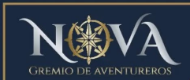

## Reto de Diseño - Unidad 7 / Word as a Playable System

# NOVA: nadie se aventura solo

*Sistema tipográfico jugable para la portada web de NOVA, Gremio de Aventureros.*

Para jugar:
https://yepescadito.github.io/Bitacora-Sistemas-Fisicos/Reto_Unidad_7/DEMO/

# La organización

**NOVA, Gremio de Aventureros** es un hobby center donde se juegan TCG (juegos de cartas coleccionables), juegos de mesa y juegos de rol. Su público son jugadores que buscan un lugar y un grupo para jugar: desde quien llega por primera vez sin conocer a nadie hasta los grupos que se reúnen cada semana.

**Atributo elegido: comunidad. La aventura es en grupo.**

En qué me baso:
- **El nombre:** se presenta como un *gremio*. En los juegos de rol, el gremio es el lugar donde los aventureros se reúnen para formar grupos y salir a sus misiones.
- **Lo que ofrece:** los tres tipos de juego que reúne (cartas, mesa y rol) se juegan con otras personas. Lo que ofrece un hobby center no son los juegos, sino la mesa con otros.
- **El logo:** la O es una brújula, un instrumento para orientarse y llegar a un destino. La usé como guía para reunir al grupo.

**Contexto de uso:** la portada de su página web. Es lo primero que ve alguien que llega buscando dónde jugar, y se juega con el mouse (o con el dedo en el celular).

# El sistema

Todo lo que se ve son letras: las cuatro de **NOVA** y las diecinueve de **GREMIO DE AVENTUREROS**. Uso la fuente Cinzel, una romana con serifas muy parecida a la del logo, y la paleta del logo: azul noche, plata y dorado.

| Elemento | Qué es | Modelo |
|---|---|---|
| **N, O, V, A** | cuatro aventureros | cuerpos rígidos con física (Matter.js), hechos de sus trazos: la N son dos palos y la diagonal, la V dos barras inclinadas, la A dos barras y el travesaño, y la O un círculo |
| **La O** | además, la brújula del gremio | su aguja está hecha de ocho letras V (las puntas de la rosa de los vientos) |
| **Letras pequeñas** | los miembros del gremio | agentes con steering (wander, seek, arrive y separación), como en la Unidad 6 |
| **Vínculo** | tomarse de la mano | restricción de distancia 0 entre un punto que las dos letras sostienen |

### Qué puede hacer la persona

- **Arrastrar y lanzar** las letras.
- **Juntarlas:** si dos letras quedan lado a lado durante 0.35 s, se toman de la mano. Lado a lado quiere decir: al alcance de la mano (a menos de 6 % del tamaño de letra), a la misma altura y las dos más o menos derechas. Apiladas o de cabeza no se unen.
- **Separarlas:** jalando fuerte (el vínculo se rompe si se estira más de 0.65 del tamaño de letra) o con **doble clic** sobre una letra, que se suelta de su grupo y da un saltito.
- **R** reinicia y **D** abre un panel con los grupos, los vínculos, quién está dormida y si hay lectura.

### Reglas

1. **Solas no se sostienen.** Una letra sola cae, queda de lado y, si pasa 2.5 s quieta, **se duerme**: se apaga a gris.
2. **En grupo se ayudan a estar de pie.** Cada letra de un grupo recibe una aceleración suave que la endereza, más fuerte cuanto más grande es el grupo. Mientras arrastras el grupo no actúa, así que puedes girarlo y voltearlo. Además se vuelve dorada: más dorada y más brillante cuanto más grande es el grupo.
3. **La brújula busca a quien falta.** La aguja de la O apunta hacia la letra más cercana que no está en su grupo. Cuando están todas, apunta al norte.
4. **El gremio va donde hay grupo.** Las letras pequeñas caminan por el suelo. Perciben a los grupos a una distancia de 160 px más 90 px por miembro: un grupo más grande se nota desde más lejos. Una letra sola no atrae a nadie. Cuando perciben un grupo, lo rodean.
5. **Solo NOVA completo y en orden se lee.** Si las cuatro están unidas, en orden de izquierda a derecha y más o menos alineadas:
   - el gremio se ordena debajo y escribe "GREMIO DE AVENTUREROS";
   - entre todos **levantan la palabra** hasta el centro de la pantalla;
   - aparece el logo completo.

   Si están unidas pero desordenadas (por ejemplo, VONA), el gremio las rodea revuelto y no forma el subtítulo.

### Qué espero que se descubra jugando

- Que una letra sola se cae y se apaga; acompañada se levanta y brilla.
- Que la brújula señala a quien falta reunir.
- Que el gremio no se interesa por una letra sola, sino por los grupos.
- Que el orden importa para que se lea el nombre.
- Que solo el grupo completo llega a lo más alto y convoca al gremio entero.

En resumen: **en NOVA nadie se aventura solo.**

# Registro de pruebas

- **Prueba 1:** la A y la V se dibujaban corridas respecto a su cuerpo físico. Matter coloca la posición del cuerpo en su centro de masa y yo dibujaba el glifo centrado en su caja. Guardo ese desfase al crear cada letra y desplazo el dibujo.
- **Prueba 2:** al unirse, las letras empezaban a girar sin control (ángulos de miles de radianes) hasta romper el vínculo. La fuerza que endereza al grupo estaba mal escalada: Matter multiplica el torque por dt² (≈278), así que mi corrección era unas 5 veces más fuerte y se pasaba de largo en cada paso. La reescribí como aceleración angular deseada dividida entre dt², con amortiguación. Ahora el grupo se endereza sin oscilar.
- **Prueba 3:** la V y la A casi nunca se unían. Con los choques exactos, una O, una V y una A puestas en fila apenas se tocan: la V es ancha arriba, la A ancha abajo y la O redonda. Cambié la regla de choque por una de cercanía: se toman de la mano si sus cajas están a menos de 6 % del tamaño de letra durante 0.35 s. Con NOVA en fila se forman los 3 vínculos.
- **Prueba 4:** la lectura funcionaba, pero la palabra quedaba en el suelo y tapaba el subtítulo. Lo convertí en recompensa: cuando NOVA está completo y en orden, el gremio lo levanta hasta el 42 % de la altura de la pantalla y ahí se lee el logo completo. Medí la altura promedio de las letras: 642 → 415 px en 8 s con la primera fuerza; la dupliqué para que subiera más rápido.
- **Prueba 5:** con las cuatro unidas pero en orden VONA, no hay lectura y el gremio completo (19/19) las rodea sin formar el subtítulo. Con NOVA, lectura sí.
- **Prueba 6:** la aguja de la brújula (V más grandes) se salía de la O y se veía como un manchón. Ahora el vértice de cada V toca el borde interior de la O.
- **Prueba 7 (jugándolo):** las letras chocaban raro y terminaban en un nudo: la A volteada metida en la V, todas unidas en posiciones absurdas. Había tres causas:
  - La A y la V eran trapecios sólidos, así que no podían encajar entre sí y se montaban.
  - Se tomaban de la mano en cualquier posición, incluso apiladas o de cabeza.
  - La fuerza que endereza al grupo era tan fuerte que no dejaba girar las letras.

  Cambios: cada letra es ahora un cuerpo compuesto por sus trazos; solo se toman de la mano lado a lado (diferencia de altura menor a 0.45 del tamaño de letra y ambas con menos de 0.6 rad de inclinación); y el enderezado es 4 veces más suave (0.012 → 0.003) y no actúa mientras arrastras. Verificación: si dejo caer la A sobre la V, la A se resbala y queda acostada sin unirse; NOVA en fila sigue formando sus 3 vínculos y el logo.

### Predicciones verificables (para la sustentación)

| Si cambio… | Predigo… |
|---|---|
| `tiempoVinculo` 0.35 → 1.5 | cuesta más formar grupos: hay que sostener las letras juntas más tiempo |
| `rupturaVinculo` 0.65 → 0.3 | los grupos se deshacen con facilidad al lanzarlos |
| `enderezar` → 0 | los grupos ya no se ponen de pie: la diferencia entre sola y acompañada se pierde |
| `percepcionGremio` → 0 | el gremio solo nota grupos muy grandes; con dos letras no se acerca |

(Los parámetros están al inicio de `DEMO/index.html`, en el objeto `R`.)

# Pruebas con otras personas

*(Pendiente: invitar a alguien a jugar sin explicarle nada y anotar qué intentó, qué descubrió y cómo lo interpretó.)*

| Persona | Qué intentó | Qué descubrió | Cómo lo interpretó |
|---|---|---|---|
| | | | |

# Autoevaluación

*(Por completar antes de la presentación: cada criterio vale 25 puntos.)*

| Criterio | Puntos | Valoración |
|---|:---:|:---:|
| Cumplimiento del encargo: mi sistema utiliza las letras del nombre de una organización, permite jugar con ellas y funciona en tiempo real en la Web para el contexto definido. | 25 | |
| Comprensión y verificación: puedo explicar y justificar el modelo, sus estados y sus reglas. Puedo predecir y verificar el efecto de modificar una regla o un parámetro. | 25 | |
| Interacción e identidad: puedo justificar qué permiten descubrir las acciones y sus consecuencias sobre el atributo elegido, y contrastarlo con lo observado en las pruebas con otras personas. | 25 | |
| Resolución tipográfica y experiencia de juego: la composición, el ritmo, los momentos de lectura y las respuestas perceptibles permiten explorar el sistema y sostienen su intención. | 25 | |
| **Total** | **100** | |

## Sustentación

1. *__Cumplimiento del encargo__*

2. *__Comprensión y verificación__*

3. *__Interacción e identidad__*

4. *__Resolución tipográfica y experiencia de juego__*
