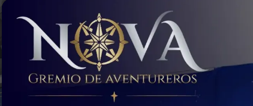
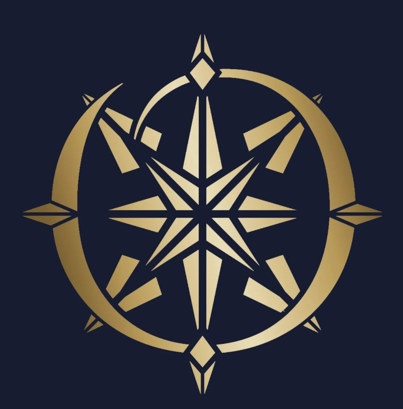

## Reto de Diseño - Unidad 7 / Word as a Playable System

# NOVA: nadie se aventura solo

*Sistema tipográfico jugable para la portada web de NOVA, Gremio de Aventureros.*

Para jugar:
https://yepescadito.github.io/Bitacora-Sistemas-Fisicos/Reto_Unidad_7/DEMO/

 

# La organización

**NOVA, Gremio de Aventureros** es un hobby center donde se juegan TCG (juegos de cartas coleccionables), juegos de mesa y juegos de rol. Su público son jugadores que buscan un lugar y un grupo para jugar: desde quien llega por primera vez sin conocer a nadie hasta los grupos que se reúnen cada semana.

**Atributo elegido: comunidad. La aventura es en grupo.**

En qué me baso:
- **El nombre:** se presenta como un *gremio*. En los juegos de rol, el gremio es el lugar donde los aventureros se reúnen para formar grupos y salir a sus misiones.
- **Lo que ofrece:** los tres tipos de juego que reúne (cartas, mesa y rol) se juegan con otras personas. Lo que ofrece un hobby center no son los juegos, sino la mesa con otros.
- **El logo:** la O es una brújula, un instrumento para orientarse y llegar a un destino. La usé como guía para reunir al grupo.

**Contexto de uso:** la portada de su página web. Es lo primero que ve alguien que llega buscando dónde jugar, y se juega con el mouse (o con el dedo en el celular).

# El sistema

Todo lo que se ve son letras: las cuatro de **NOVA** y las diecinueve de **GREMIO DE AVENTUREROS**. La N, la V y la A usan **Cinzel Decorative**, una romana con los remates curvos del logo (el trazo que abre la N y las colas de la V y la A), en plata metálica. El gremio usa **Cinzel**. La paleta es la del logo: azul noche, plata y dorado.

| Elemento | Qué es | Modelo |
|---|---|---|
| **N, O, V, A** | cuatro aventureros | cuerpos rígidos con física (Matter.js), hechos de sus trazos: la N son dos palos y la diagonal, la V dos barras inclinadas, la A dos barras y el travesaño, y la O un círculo |
| **La O** | además, el emblema y la brújula del gremio | el emblema dorado del logo armado solo con letras: el aro es la O; los rombos de los puntos cardinales son una A volteada sobre una V; las puntas de afuera son V delgadas; los bloques de las diagonales son letras I; y la estrella son 8 V afiladas, cada una con una mitad clara y otra oscura (las facetas). La estrella hace de aguja, y su punta principal es más clara |
| **Letras pequeñas** | los miembros del gremio | agentes con steering (wander, seek, arrive y separación), como en la Unidad 6 |
| **Vínculo** | tomarse de la mano | restricción de distancia 0 entre un punto que las dos letras sostienen |
| **Íconos** | lo que se hace en NOVA: cartas (TCG), dado (juegos de mesa), d20 (rol) y trofeo (torneos) | armados con letras: los trazos son letras I estiradas entre dos puntos, los puntos del dado son O pequeñas y el trofeo también es de trazos de I (copa en media elipse, asas en arco, pie y base) |

### Qué puede hacer la persona

- **Arrastrar y lanzar** las letras.
- **Levantar** una letra: al agarrarla, se pone de pie.
- **Juntarlas con la O:** todo empieza en la O. Una letra se une si la dejas lado a lado con la letra que le corresponde durante 0.25 s. Lado a lado quiere decir: al alcance de la mano (a menos de 15 % del tamaño de letra), a la misma altura y las dos más o menos derechas. Si acercas una letra a otra que está tirada, la tirada se levanta para recibirla.
- **Separarlas:** jalando fuerte (el vínculo se rompe si se estira más de 0.65 del tamaño de letra) o con **doble clic** sobre una letra, que se suelta de su grupo y da un saltito.
- **R** reinicia y **D** abre un panel con los grupos, a quién busca la brújula y si NOVA está completo.

# Autoevaluación

| Criterio | Puntos | Valoración |
|---|:---:|:---:|
| Cumplimiento del encargo: mi sistema utiliza las letras del nombre de una organización, permite jugar con ellas y funciona en tiempo real en la Web para el contexto definido. | 25 | 25 |
| Comprensión y verificación: puedo explicar y justificar el modelo, sus estados y sus reglas. Puedo predecir y verificar el efecto de modificar una regla o un parámetro. | 25 | 25 |
| Interacción e identidad: puedo justificar qué permiten descubrir las acciones y sus consecuencias sobre el atributo elegido, y contrastarlo con lo observado en las pruebas con otras personas. | 25 | 20 |
| Resolución tipográfica y experiencia de juego: la composición, el ritmo, los momentos de lectura y las respuestas perceptibles permiten explorar el sistema y sostienen su intención. | 25 |25 |
| **Total** | **95** | 4.7 |

